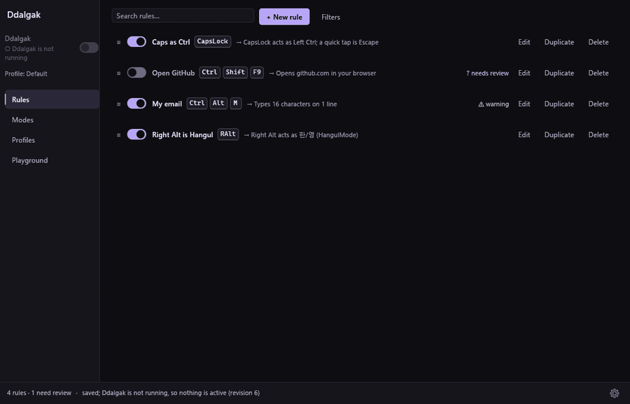
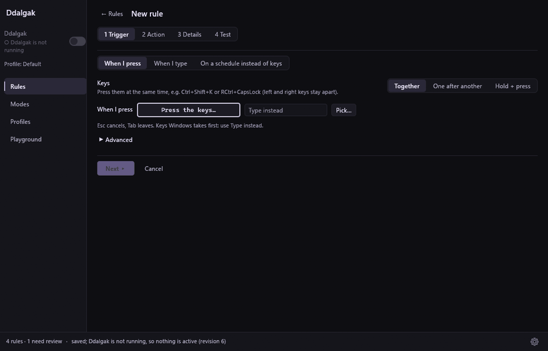
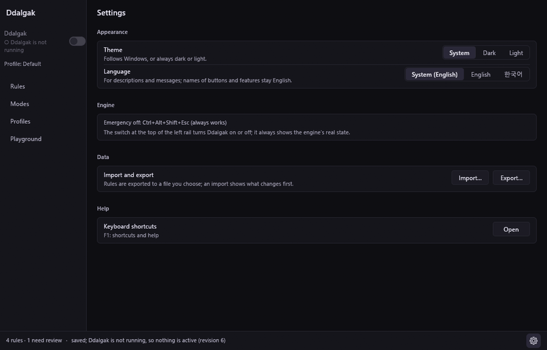
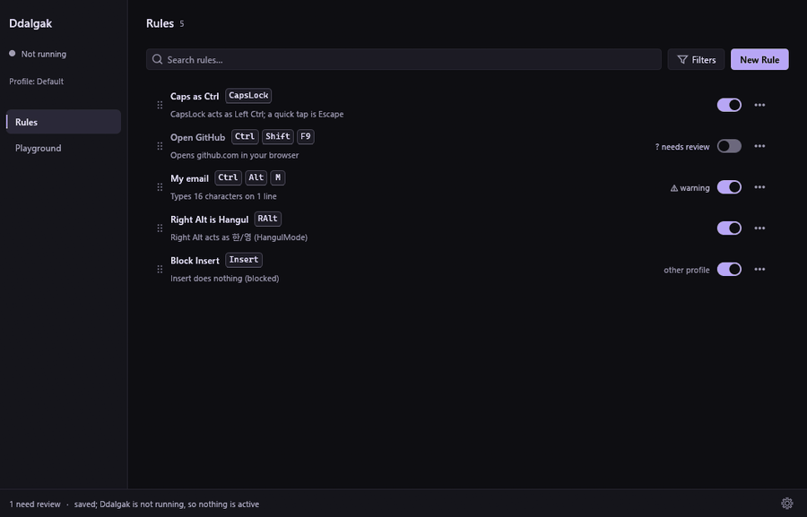
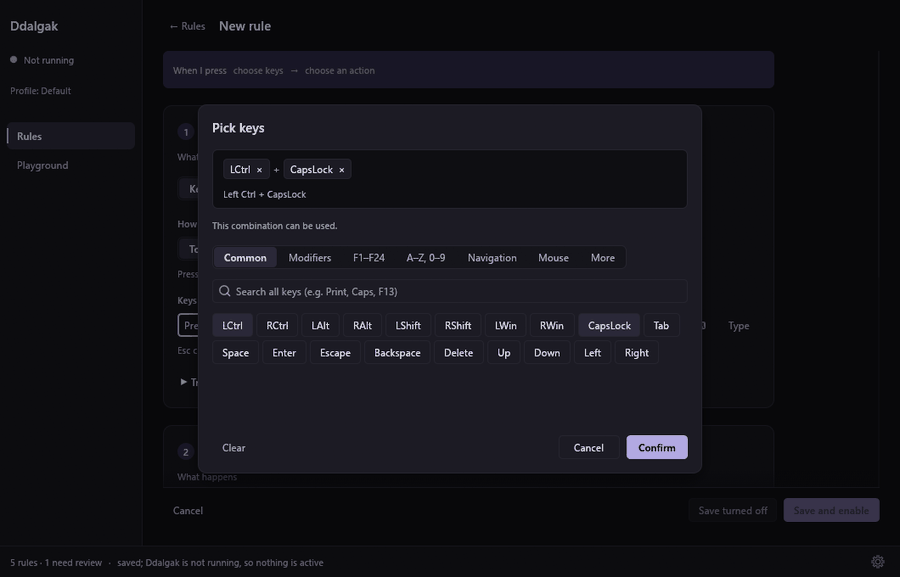
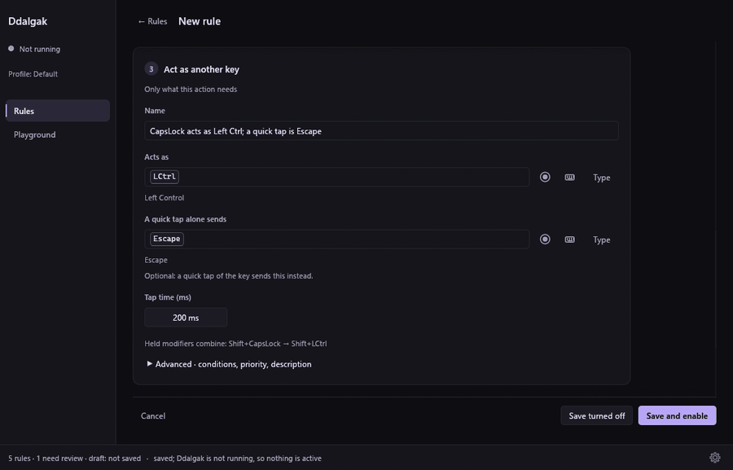
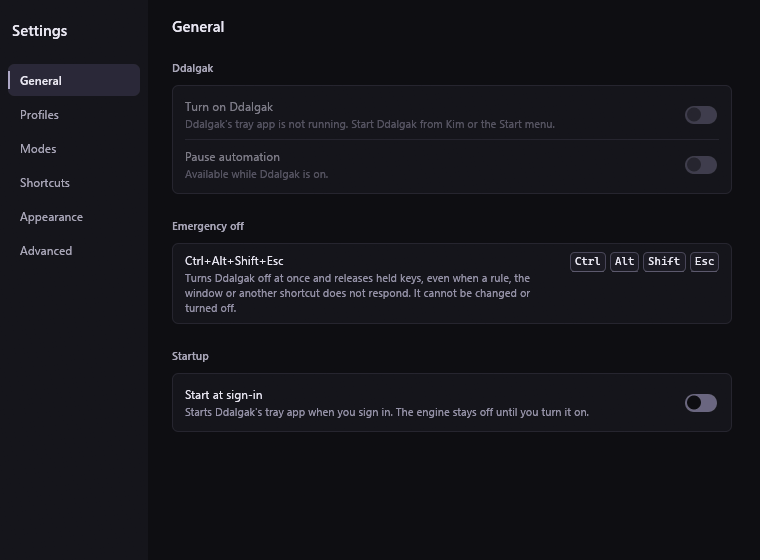

# Ddalgak UI audit: before and after ADR 0100

Status: current (ADR 0100, 2026-11-16). Measured on the maintainer's PC (one 5120 × 1410
monitor, Windows 10 Pro 19045) with sandboxed copies of each build, a private endpoint and the
UI fixture `design/ui-fixtures/ddalgak-rules.json`. Pixel values are physical pixels at a UI
zoom of 100 % unless a zoom is named. Workflow: [UI_QUALITY_PIPELINE](UI_QUALITY_PIPELINE.md).

## 1. Before (Ddalgak editor 0.0.3, `main` c115399)

| Screen | Before |
|---|---|
| Rules |  |
| New rule (step 1 of 4) |  |
| Settings (a page replacing the main view) |  |

Measured (geometry report and the screenshots):

| Finding | Measurement |
|---|---|
| The editor mostly bypassed the design system | 214 raw egui widget calls (`egui::Button`, `TextEdit`, `ComboBox`, `checkbox`, `radio_value`, `DragValue`) against 37 `kim-ui` component uses in `ddalgak-editor/src/app/*` |
| …so the audit could not see them | the Rules report listed 30 components; the search field, combo boxes, checkboxes, radios and the key field were absent |
| Toolbar heights differed | search field 24 px (egui's interact height) beside New rule 28 px and Filters 28 px; Filters a borderless ghost of 55 px, search a fixed 240 px |
| The main window carried engine, profile, mode and settings | rail: the engine switch, Pause/Resume, profile, mode; nav: Rules, Modes, Profiles, Playground; Settings replaced the page |
| Every row showed three text buttons | Edit 36 × 24, Duplicate 66 × 24, Delete 50 × 24 on each row, plus badges |
| The new-rule form was a four-step wizard | `1 Trigger · 2 Action · 3 Details · 4 Test` hid each other; the key field was a 200 × 28 capture button, a 160 px "type instead" field and a 48 × 24 "Pick…" — three sizes in one row |
| The key picker | one flat list; `Ctrl` beside `LCtrl`; no per-key removal; Confirm accepted `LShift+RShift` (the engine's parser refuses it) and `RAlt+Tab` (reserved by Windows) |

User journey for one simple rule (CapsLock → type a phrase), before: New rule → (capture box
already recording; CapsLock toggles the lock instead of being captured) → Pick… → find CapsLock in
the flat list → Confirm → Next → choose a tile → (jumps to Details) → type the text → Next →
Simulate → Save and enable → Allow. Nine clicks across four hidden steps, with the result of each
step invisible from the others.

## 2. After (Ddalgak editor 0.0.4)

| Screen | After |
|---|---|
| Rules |  |
| Key picker: CapsLock with Left Ctrl, left/right modifiers |  |
| The chosen action's settings (Act as another key) |  |
| Settings, a window of its own (760 × 560) |  |

Measured from the same reports:

| Item | After |
|---|---|
| Raw egui widgets | Rules, rule editor and Settings: 0. Remaining: playground 13, macro steps 8, dialogs 9 (text fields, combo boxes, selectable labels) — all at the control height (egui's interact height is now `size::CONTROL` = 28) |
| Toolbar | search 677 × 28 at x 192, Filters 75 × 28 at 877, New Rule 76 × 28 at 960: one height, one line (y 64), gaps 8 and 8 (`space::S`); with a search typed the gaps stay 8 (the clear button no longer pushes Filters under the field) |
| Rule rows | 52 px (`size::LIST_ROW_DETAIL`): name and keycaps over the summary; badges, the switch and one `⋯` menu (28 × 28) |
| Rule editor | one page; sections 720 px wide (`size::FORM_MAX_WIDTH`); 12 action cards 165 × 56 in a 4-column grid; footer Cancel · Save turned off · Save and enable |
| Gear | 28 × 28 at the lower-right corner (12 px from the right edge, 4 px from the bottom) |
| Settings | a separate native window *Ddalgak Settings*, 760 × 560 at 100 % (1140 × 840 at 150 %) |

Journey after: New Rule → Pick keys → CapsLock → Confirm → Type text card → type → Simulate →
Save and enable → Allow, all on one page with the sentence *When I press [CapsLock] → Types 12
characters on 1 line* above the sections.

## 3. Automated audit (`cargo xtask ui-audit`)

- Ddalgak: 14 screens (rules, rules with a search, the empty state, filters, new rule, key picker,
  two action forms, six Settings sections) × zoom 100/125/150/200 % dark English + 150 % light
  Korean = 70 runs, **0 layout failures, 0 warnings** (final run).
- All programs: 138 runs, 0 failures, 0 warnings, baselines re-recorded after review (final run). Ddalgak's first full run reported 30
  `form-width` failures (sections 8–24 px wider than the column: the *Type* button's padding was
  under-counted), fixed, then 0.
- New rules (ADR 0100): `toolbar-height`, `toolbar-align`, `toolbar-gap` (the toolbar gap; a gap
  of two gaps or more is a deliberate spring), `gear-corner`, `form-width`, choice-card size and
  width, checkbox and number-field heights, key-picker keys ≥ 36 px. A unit test feeds a broken
  toolbar (24 px search, a control 3 px low, a lost gear) and expects each failure.

## 4. Real Windows journeys (real mouse and keyboard)

Script `ddux.ps1` (scratchpad), run `r7`: sandboxed copies of this build (editor SHA-256
`82836AC7…`), the observe-only test host (`ddalgak-gui --test-host`: it never consumes or sends
keys), click points from the windows' own reports, results read back from `rules.json`,
`editor.json` and `ddalgak status`. The maintainer's own Ddalgak (0 rules, no global shortcuts),
Noeul and Subak were not touched (checked by PID at the end).

| Journey | Result |
|---|---|
| Search "mail" | 4 rows → 1; Esc clears → 4 |
| Filters | popover opens, Esc closes it |
| CapsLock rule with the key picker, Type text, Simulate, Save and enable, Allow | saved `CapsLock → type_text "Kind regards"`, enabled |
| Ctrl+Shift+K recorded with real keys, Act as another key, *Type* F20, Save turned off | saved `Ctrl+Shift+K → F20`, off |
| RCtrl + Space picked, Open a website `github.com`, Simulate, Save turned off | saved `RCtrl+Space → https://github.com/`, off; no browser window opened |
| Row menu: Duplicate, Disable, Delete (with confirmation) | +1 rule, `enabled: false`, the copy deleted |
| Gear → Settings | a separate window *Ddalgak Settings* |
| Turn on Ddalgak, Pause, Resume, Turn off | `ddalgak status`: off → running → paused → running → off |
| Profiles: new "Travel", Switch to Gaming | profiles `default,gaming,travel`, active `gaming` |
| Modes: new "Symbols" | added to the active profile (Gaming) |
| Appearance: Light, Dark | `editor.json` theme `light`, then back |
| Gear again | still one Settings window |
| Close Settings | the editor keeps running |
| Narrow (760 × 560) and wide (1900 × 1000) windows | toolbar 28 high on one line, 12 px gaps at 150 %; rows clip, never overlap |
| Regression | `ddalgak rule check`: 0 errors; the fixture's rule order kept, new rules appended |

Defects the real runs found and that were fixed (each with a regression test where the harness
can show it):

1. A mode added in Settings → Modes went to the profile of a rule open in the main window, not to
   the active profile Settings shows (`a_mode_added_in_settings_goes_to_the_active_profile`).
2. Choosing a theme switched a `--lang en` window to Windows' language (pre-existing;
   `choosing_a_theme_keeps_the_language`).
3. Esc in the search field did not clear it (egui's text edit gives up the focus on the same key).
4. With text in the search field, Filters slid 20 pt under it (the inner text edit moved the
   toolbar's cursor; the new `toolbar-gap` rule and the `rules-search` screen now catch it).
5. In a narrow window a rule's keycaps were drawn under its switch (the text block is clipped).
6. A second new rule opened scrolled to where the previous one ended (each rule now has its own
   scroll position).
7. An empty key field said "``: give one to 1 keys or chords" (now "choose a key" / "키를 고르세요").
8. A race in the editor's worker made a unit test flaky (the window is woken before the job counts
   as done).

Test-script mistakes on the way (not app defects, recorded for honesty): a UTF-8 BOM in the seeded
`rules.json` (the editor correctly refused it as `rules_invalid`), reading `bounds.w` instead of
`bounds.width` (clicks landed on control corners), and a report read while the window rewrote it
(reports are now written atomically).

## 5. Kim Settings convention

- Ddalgak: Settings in its own window (this change).
- Kim Manager: Settings now opens as *Kim Settings* in its own window (`size::SETTINGS_WIDTH ×
  HEIGHT`); the launcher stays as it is; Esc or the close button closes it; its 20 headless tests
  pass. Real desktop (sandboxed copy, `C0E60F9A…`): the launcher stays 568 × 375, the gear opens
  *Kim Settings* (976 × 759 at 150 %), the gear again keeps one window, Esc closes it, the
  launcher keeps running.
- Noeul: its settings were already a separate program window (unchanged).
- Subak: the gear keeps its native menu; no settings panel covers the terminal.

## 6. Not done or not verified

- The playground and some dialogs still use egui text fields and combo boxes (at the control
  height, not recorded by the audit).
- 125 % and 200 % were measured by the audit (UI zoom), not by changing Windows' display scaling;
  a second monitor is not available on this PC (not tested).
- High Contrast was not tested on the real desktop.
- Global shortcut changes apply when the tray app starts next (it reads `hotkeys.json` once).
- The real-desktop journeys covered the main paths; mouse actions, schedules, macros and import
  were exercised by the headless tests only.
